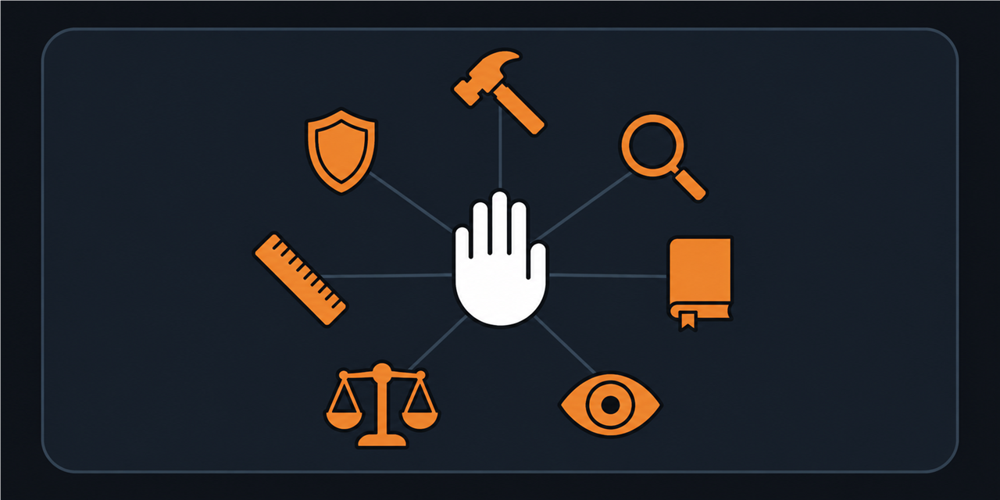

# Claude Code Harness Toolbox

[](https://www.claudepluginhub.com/plugins/dtiger1889-ops-mackforge-harness-toolbox?ref=badge)

A tested, empirically grounded harness for durable work across coding agents, with
[Claude Code](https://claude.com/claude-code) as the reference implementation. Its
file-based state and checkpoint patterns work with Codex and other file-capable agents
too. Its hooks ship for Claude Code, plus a smaller Windows set for Codex (see
[Codex hooks](#codex-hooks-windows-powershell) for what Codex enforces today).



**The core problem:** coding agents have finite, session-bound context.
Without a harness, every session starts from scratch, re-reading the same files, with no
reliable way to know what was done, what's open, or where to pick up. This toolbox is the
storage layer: `CLAUDE.md` for stable facts, `CHECKPOINT.md` for compressed mutable state,
hooks that surface and enforce them, and a suite of skills that encode the conventions so
you never re-explain them.

## Install

### The guided install (recommended; any file-capable agent)

Flip over to the "</> Code" tab in Claude Desktop (or open a fresh Claude Code session),
set the permission mode to Manual or Accept edits for your security, set the model to
Sonnet or Opus, and paste:

> Read this repository and tell me if it will help improve my Claude workspace:
> https://github.com/dtiger1889-ops/claude-harness-toolbox

Claude will ask for your permission to fetch and read this page before it tries to
download anything. When you're ready to install, [`harness_me.txt`](harness_me.txt) is the
machine-oriented installer Claude follows. It collects the workspace, OS, pace, and
selected components once; then it executes an explicit preflight → install → verify →
rollback-record contract. Design rationale stays here in the README and in the benchmark,
with configuration, maintenance, and historical guidance under [`docs/`](docs/), so an
installing session does not pay to parse them.

### Skills and hooks only: the Claude Code plugin

If you already have your own `CLAUDE.md`/`CHECKPOINT.md` setup and only want the skills
and hooks, install the plugin from inside a Claude Code session (v2.1.275 or later):

```
/plugin install mackforge-harness-toolbox --marketplace dtiger1889-ops/claude-harness-toolbox
```

Claude Code adds this repository as a plugin source, then installs the plugin from it
(older versions: `/plugin marketplace add dtiger1889-ops/claude-harness-toolbox`, then
`/plugin install mackforge-harness-toolbox@harness-toolbox`). You get the seventeen
skills as `/slash` commands and the hooks wired automatically. The plugin does **not**
create the workspace scaffold; the guided install above does. To try it for one session
from a local clone, run `claude --plugin-dir ./claude-harness-toolbox`.

**Platform caveat.** The hooks the plugin wires are the Windows PowerShell set
([`hooks/hooks.json`](hooks/hooks.json)) — the maintainer's live, tested reference. On
macOS/Linux the skills work as-is, but replace the installed plugin's `hooks/hooks.json`
with [`hooks/hooks-macos-linux.json`](hooks/hooks-macos-linux.json) (the bash orientation
gate plus the receipt and compaction reminder), or skip the plugin's hooks and wire
`hooks/settings-macos-linux.example.json` by hand as described below. Neither bash path
has been verified on that hardware.

### By hand (no plugin support, or another agent)

- **Skills**: copy any folder from [`skills/`](skills/) into `~/.claude/skills/<name>/`.
  Each becomes a `/slash` command in every project.
- **Hooks**: copy the scripts from [`hooks/`](hooks/) into `~/.claude/hooks/` and merge
  the matching `settings-*.example.json` block into your **user-level**
  `~/.claude/settings.json`. (User-level is load-bearing: workspace-level hooks silently
  never fire for sessions opened inside project subfolders.)
- **Templates**: [`templates/`](templates/) holds the skeletons for bootstrapping new
  projects (`CLAUDE.md`, `CHECKPOINT.md`, and a baseline `.gitignore`).

### Codex hooks (Windows PowerShell)

[`hooks/codex/`](hooks/codex/) is a smaller hook set in Codex's own format: a session
receipt, an orientation gate and a compaction reminder. The gate is not proof of a full
read: it records that a read command naming your project's `CLAUDE.md` and
`CHECKPOINT.md` was run, and blocks other local actions until both were. The Claude Code
`guard.ps1` is left out, because it assumes MSYS bash and Codex runs shell commands in
PowerShell on Windows.

**What Codex enforces:** in live `codex exec` probes on Codex 0.164.0-alpha.11.1 (Windows),
the gate blocked a command before both files were read (Codex printed "PreToolUse
Blocked") and let it run after both were read. The gate answers with Codex's JSON
`permissionDecision: "deny"`: an earlier version used exit code 2 with the reason on
stderr, which Codex reported as "Failed" and did not enforce for this PowerShell hook. If
you write your own Codex hooks on Windows, use the JSON form.

1. Copy the `hooks/codex/` folder to `~/.codex/hooks/harness/`.
2. In its `hooks.json`, replace every `<HOOKS_DIR>` with that folder's absolute path using
   forward slashes (the absolute form of `~/.codex/hooks/harness`).
3. Merge the result into `~/.codex/hooks.json`. Optional: set `HARNESS_WORKSPACE_ROOT` to a
   folder holding a `CLAUDE.md` and `CHECKPOINT.md` as a fallback for sessions started
   outside any project.
4. Open `/hooks` in Codex and trust each new hook: Codex keeps changed or new hooks inactive
   until their hash is approved.

Check the scripts with `powershell.exe -NoProfile -File <folder>/orient_gate_tests.ps1`,
where `<folder>` is your clone's `hooks/codex` or the installed `~/.codex/hooks/harness`
(absolute path); it needs nothing outside that folder.

## What's inside

`harness_me.txt` — the machine-oriented installer described in "The guided install" above.

### Skills (`skills/<name>/`)

Copy any folder into `~/.claude/skills/<name>/`. Each becomes a `/slash` command in every project.

| Skill | What it is |
|---|---|
| `checkpoint` | `/checkpoint`: updates verified resume state in place while preserving the project's existing schema and immutable history. Bundled helpers check paths and stale threads, stamp real UTC, sort tagged work, and enforce 120-line/~30KB limits. The finisher selects oldest changelog entries for byte-preserving overflow archival; a separate mover supports explicit ranges. **Helpers require PowerShell 5.1+ or `pwsh` 7+.** Without them, the skill records validation and archival limitations. |
| `prevent` | `/prevent`: when a documented rule got violated because it wasn't in the agent's read path: fix the slip, find the knowledge, diagnose why it missed, and move it to where the failing workflow will actually read it. If you build only one skill, build this one. |
| `outside` | `/outside`: one cheap external-grounding pass before committing to an approach: shipped-solutions sweep, sibling-project sweep, notes check; verdict-first report with exactly one next action. The "did someone already build this?" gear the rest of the suite lacks. |
| `grill-me` | `/grill-me`: resolves meaningful unanswered requirements before a new build, with interview depth matched to the uncertainty. Reuses existing answers and authorization, records a brief with an `Agreed:` line identifying its status, and skips re-interviewing an agreed spec. Idea from Matt Pocock's [grill-me](https://github.com/mattpocock/skills), by way of Ruben Hassid's adaptation. |
| `log` | `/log`: writes a finding the last answer produced (a proof, a correction, a small decision) into the doc that already owns it, since none of that is resume-state and `/checkpoint` would never save it. Also files the session's own rule-breaking in an append-only lapse ledger (JSON Lines, one record per mistake) through `log_lapse.ps1`: the script numbers the record, reads the model and effort from the session transcript instead of asking the model, and flags a likely repeat before appending. A repeat asks for a stronger general rule for that family of mistake, not a new rule for the one incident. `ledger-template.md` starts a ledger. **Requires `pwsh` 7+ or PowerShell 5.1+.** |
| `prove` | `/prove`: extracts every factual claim from the last response and verifies each against files first, then the web; per-claim Confirmed / Wrong / Unverified with citations. |
| `redteam` | `/redteam`: one adversarial pass that assumes the target is wrong and hunts the fatal flaw. The cheap middle gear between a single-shot answer and `/fanout`. |
| `dumb` | `/dumb`: investigates a correction to the previous work, names the actual failure, and completes the fix within the user's authorized scope. Records reusable findings without automatically making one-off feedback permanent policy. |
| `fanout` | `/fanout`: five distinct ideation agents plus a critic for open-ended problems, invoked explicitly. Uses native agent tools within the host's concurrency limits, batching when needed. Cost depends on the models, context and output; six helper calls usually consume more than a single review. |
| `new-project` | `/new-project`: scaffolds a project from [`templates/`](templates/) and then registers it everywhere it must appear (the project ledger, any container index, its backup lane), because a project no index names is invisible to every later session. Asks only the name, location and backup-lane questions the conversation hasn't answered, and ends with a checklist that re-reads each index. |
| `vet` | `/vet`: decides whether someone else's repo, skill, plugin or MCP server earns a place in your setup. Dedupes against past verdicts first, kills candidates on cheap gates (identity, liveness, license, entry cost) before any deep read, judges fit against a written-down pain, and records one of five verdicts in a ledger so nothing gets evaluated twice. Default: steal the pattern, don't install the thing. |
| `decisions` | `/decisions`: shows only the choices that are genuinely yours to make in a project, each with its options and what every option costs and unblocks. Reads the CHECKPOINT's open threads (plus an optional folder of markdown task notes), runs each through a fixed test (a real fork, needs your judgment, live now) and prints the verdicts before building anything, so technical forks, chores and scheduling never reach you. The board is a hosted page where you click your picks when the session can publish one, otherwise a numbered list in chat; the next run writes your picks back onto the threads. A collector script, a validator (with tests) and the page template are bundled. **Requires PowerShell 5.1+ or `pwsh` 7+ and Python 3.** |
| `breakdown` | `/breakdown`: convergent, action-first decomposition: real goal, smallest next action, the one blocking decision, collapsed plan, first trap. |
| `plain` | `/plain`: re-explains a dense/jargon response in plain generous English, resolving every invented code by looking it up (never guessing). `/plain show` redraws it as the smallest plain-text picture instead (pseudocode, a call tree, a file tree, or a diff of one). |
| `spec` | `/spec`: writes lean specs with a mandatory Closeout section and forces the archive/promote step when the work ships, so dead specs stop piling up looking live. |
| `spinoff` | `/spinoff`: moves a side topic into its own new session, started from a short brief of just that topic instead of a copy of the whole conversation, so the session you were in stays on topic and stops growing. Uses your own session launcher if you have one, otherwise `claude --bg`. The new session messages a short result back only when the outcome changes the original session's work. |
| `necromancy` | `/necromancy`: recovers a session that died before CHECKPOINT.md was written: a deterministic PowerShell script digests the on-disk session JSONL (anchors: first ask, user decisions, files written, commands, commits, errors) so the model never reads multi-MB raw transcripts. Pattern adapted from [ryanthedev/herderp](https://github.com/ryanthedev/herderp)'s session-necromancy. |

### Hooks (`hooks/`)

Copy the scripts into `~/.claude/hooks/` and merge the matching `settings-*.example.json` block into your **user-level** `~/.claude/settings.json`.

| Hook | What it is |
|---|---|
| `orient_gate.ps1` / `.sh` | PreToolUse **orientation gate**: blocks the first state-changing tool call of a session until CHECKPOINT.md has been read, then gets out of the way (block-once, fail-open; read-only tools are never gated). |
| `grill_gate.ps1` | UserPromptSubmit + PreToolUse **interview gate** (Windows only, no bash port yet): when a prompt reads like a build kickoff ("build me a...", "set up a new..."), it reminds the session to run `/grill-me`; if the session then tries to write a file without asking a single question, that first write is blocked once. The reminder alone is advice a model can skip; the write block is what makes it stick. Opt out in the prompt with "just build it" or "no questions". Stacks with the orientation gate: on a fresh session, each can block the first write once. |
| `guard.ps1` | PreToolUse **mechanical guard**: blocks tool input that would literally break parsing (Windows-specific: non-ASCII into PowerShell, backslash paths into MSYS bash) plus `grep --no-ignore`, a ripgrep-only flag that makes GNU grep exit 2 printing nothing, so a scan that never ran is indistinguishable from a clean one. Worth having if any gate of yours is a grep. Adapt to your own breakages; never block style. |
| `deny_backstop.ps1` | PreToolUse **security backstop**: scans the complete Bash/PowerShell command, including command substitution and loop bodies, and blocks a narrow set of catastrophic operations. It includes broad name/pattern/pipeline process kills, requiring an explicit PID instead, and any command that reads `~/.claude/.credentials.json` (outside an interactive session that file is a stale token cache, so a script reading it gets a 401; usage numbers belong to the statusline JSON). Review and adapt its patterns before enabling it. |
| `tmux_receipt.ps1` | SessionStart **environment receipt** (optional): detects a tmux/SSH-launched session (stripped PATH, different world than the desktop) and tells the session so, once, at start, so it stops re-deriving "tool not installed" conclusions from bare-name failures. It requires both a tmux/MSYS2 marker and an SSH marker, because either one alone fires falsely on desktop sessions. It also warns that permission prompts show only in that terminal, so someone following the session from another view sees a stalled call. Silent no-op on desktop launches; adapt detection + message to your own remote launch path. |
| `log_backstop.ps1` | PostToolUse **`/log` reminder** (Windows only): after `/prove`, `/prevent`, `/fanout`, `/outside`, or `/dumb` runs, it tells the session to run `/log` before ending the turn, so what those skills found gets written to the doc that owns it. A reminder, not a block (the skill already ran); `/log` stops at "nothing to log" when there is nothing durable. |
| `settings-*.example.json` | The SessionStart receipt + PreCompact reminder + PreToolUse hooks, wired for Windows and Mac/Linux. The Windows example also wires the optional security backstop and the `/log` reminder. For the by-hand install. |
| `hooks.json` / `hooks-macos-linux.json` | The same wiring in plugin form, using the plugin's own root path so there is nothing to edit. `hooks.json` (Windows) is what the plugin loads; swap in `hooks-macos-linux.json` on Mac/Linux. |

### Tools (`tools/`)

| Tool | What it is |
|---|---|
| [`codex-native/`](tools/codex-native/codex-native.md) | **Native Codex bridge** (Windows, optional): makes headless `codex exec` / `review` / `app-server` calls work from SSH or Windows session 0, including tmux started over SSH, by relaying them to an on-demand task in your signed-in desktop session. Installer, launcher templates and tests included. |

### Docs (`docs/`)

| Doc | What it is |
|---|---|
| `configuration-guide.md` | The optional configuration tour: permission and settings scope, hooks, skills, MCP, memory choice, compaction, and context-budget checks. Cosmetic settings and model rankings are deliberately excluded. |
| `maintaining-the-harness.md` | The human maintenance procedure that was deliberately removed from the installer: file budgets, the two-pass rulebook diet, contradiction checks, and outside-audit workflow. |
| `design-history.md` | A dated record of the public patterns reviewed, what this toolbox adopted or declined, and the choices it added. It is design history, not a current market survey. |
| `when-it-pays-off.md` | What the benchmark measured, in practical form: cost by task shape (no task got cheaper; trivial tasks cost more), the 2026-10-17 correction, five rules that still hold, and where the harness fits. Read before installing if you're unsure the harness fits your work. |
| `token-efficiency.md` | Operating habits that keep sessions cheap: model-tier principles (deliberately no model names), the sub-agent cost gate, and file/reading habits like front-loading resume-critical sections. |
| `optional-add-ons.md` | Concept sketches beyond the default install: a capture-first rants/musings folder and a Cowork sibling workspace layout, plus a pointer to the shipped Codex bridge. |

### Templates (`templates/`)

Per-project `CLAUDE.md` / `CHECKPOINT.md` skeletons and a baseline `.gitignore`.

## Why trust any of this

The design choices are measured, not vibes, including the measurement that came back
against the harness:

- **154 paired Claude Code trials** (two-sided Wilcoxon on paired differences) found
  that **no task got cheaper with the harness**. On trivial tasks, or when the prompt
  already says where to look, it cost 14–31% more; with the harness pre-built on one
  structured task it cost 7% more; everywhere else, including the
  multi-folder exploration tasks it was built for, it was roughly cost-neutral (−5% to
  +6%, not significant). An earlier version of this README claimed 25–45% savings on
  exploratory work; that came from a counting error in the original analysis and was
  corrected on 2026-10-17. Every trial was one fresh session, so the harness's real job,
  resuming work in a later session, was not tested. Every trial ran on a single pinned
  model, `claude-sonnet-4-6` (early-to-mid 2026, before the Claude 5 family), so these
  numbers describe that model only. The whole experiment, with the correction, the raw
  per-trial data and the benchmark itself, is published at
  [**harness-benchmark-report**](https://github.com/dtiger1889-ops/harness-benchmark-report).
- **A 50-session audit** found the model self-classifies "am I already oriented?"
  unreliably (~1 in 5 actionable sessions acted before reading state). That killed the
  original prose rule and produced the orientation gate: read-only work is free
  automatically, and the action boundary is enforced by a hook instead of judgment.
- **A 631-session transcript crawl** chose the skill list. Claude Code keeps a transcript
  of every session on disk, so before building any skills, a script searched 631 of the
  maintainer's real sessions for every place the model got told it was doing something
  wrong. The guess going in was that the most common complaint would be "this is too
  complicated, simplify it." That complaint barely appears in the record. The one that
  appears constantly is laziness: the model answering "can't determine" when the data to
  decide was already loaded, or describing what it could do instead of doing it. Those are
  the failures the skills above go after. Crawl your own transcripts before you copy the
  list; the problem you keep hitting may not be the one you'd guess.

Two limits are worth knowing before you install rather than after. In a single fresh
session the harness does not save money: what it offers is continuity across sessions,
which the benchmark did not measure. And there is no evidence that it relieves
context-window pressure, so if what you want is a cheaper single session or relief from
hitting the context limit, this is the wrong tool for it.

## Design principles (the short version)

1. **Harness beats model.** Fix session failures by improving the files, not by retrying.
2. **Receipt, not dump.** Hooks print a byte/line receipt and make Claude Read the file.
   Large hook output truncates silently to a ~2KB preview that looks complete.
3. **Enforce structurally what prose can't.** A notice the model can ignore isn't enough;
   a block-once, fail-open gate at the action boundary is.
4. **Overwrite in place, never append.** CHECKPOINT is a whiteboard, not a log. It has hard
   caps and a byte-faithful archive path for the one section that *is* a log.
5. **Promote failing rules into tools.** A rule you've re-written three times and still
   violated is the textbook case for a skill or a hook.
6. **Build for friction you can prove.** Crawl your own transcripts first.
7. **Right layer beats more prose.** A fix goes in the narrowest layer guaranteed to be
   read or fired at the failure point: a hook for tool-event patterns, a skill for
   procedures, an on-demand index for lookup data (project ledgers, routing tables).
   The always-loaded file is only for rules every session needs, and it has a real
   budget: Claude Code warns at ~40k characters, and everything under that ceiling
   taxes every turn.

The setup choices are explained in [`docs/configuration-guide.md`](docs/configuration-guide.md),
the operational version of principle 7 is in
[`docs/maintaining-the-harness.md`](docs/maintaining-the-harness.md), and the dated comparison
that informed the toolbox is preserved in [`docs/design-history.md`](docs/design-history.md).
The practical reading of the benchmark numbers above is
[`docs/when-it-pays-off.md`](docs/when-it-pays-off.md); day-to-day operating habits are
[`docs/token-efficiency.md`](docs/token-efficiency.md).

## Platform note

Windows-first: the PowerShell hooks are the maintainer's live, tested reference. Bash
ports are provided for Mac/Linux but have **not** been verified on that hardware. Run the
first-session checklist (`harness_me.txt` Section 6) before relying on them.

## License

[MIT](LICENSE).
